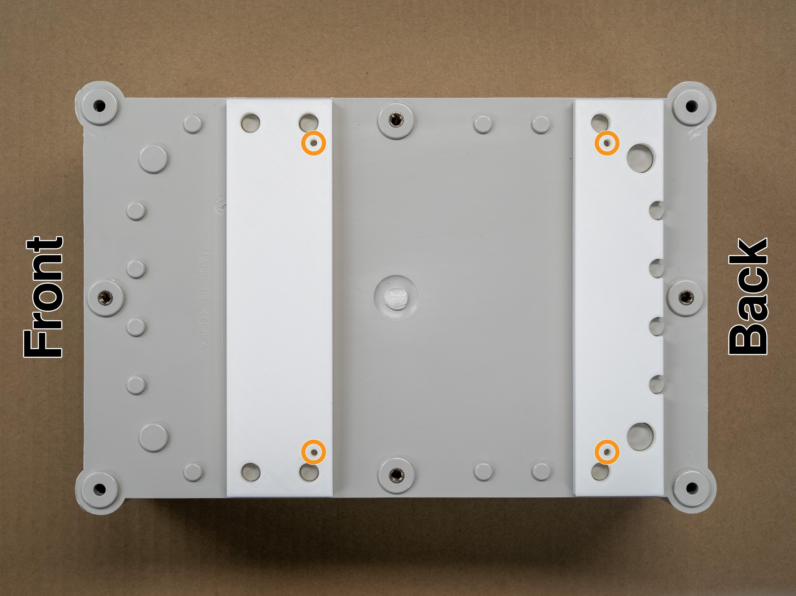
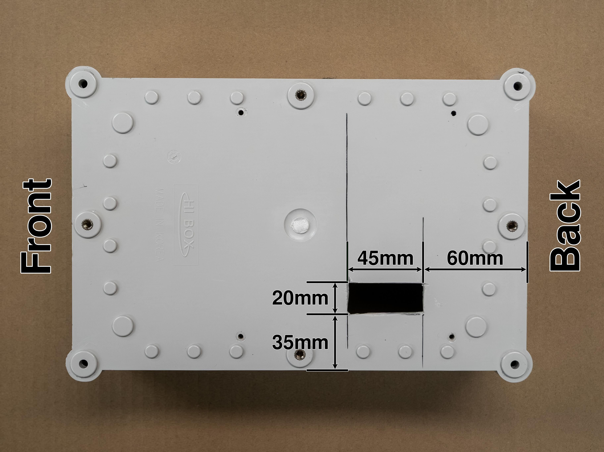
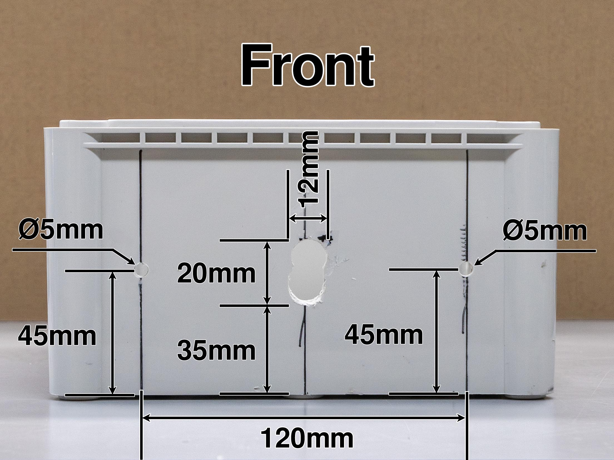
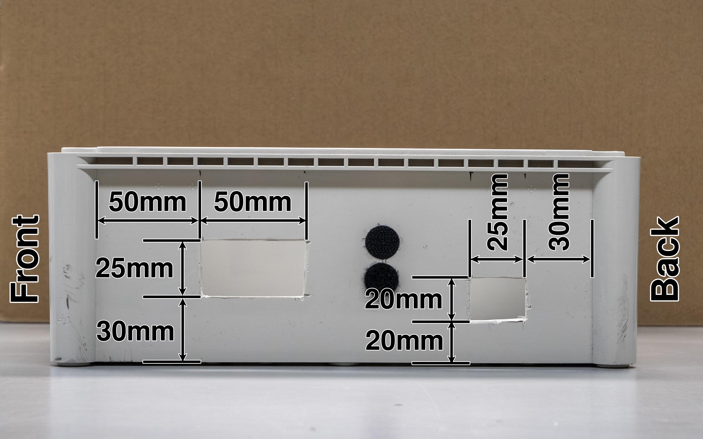
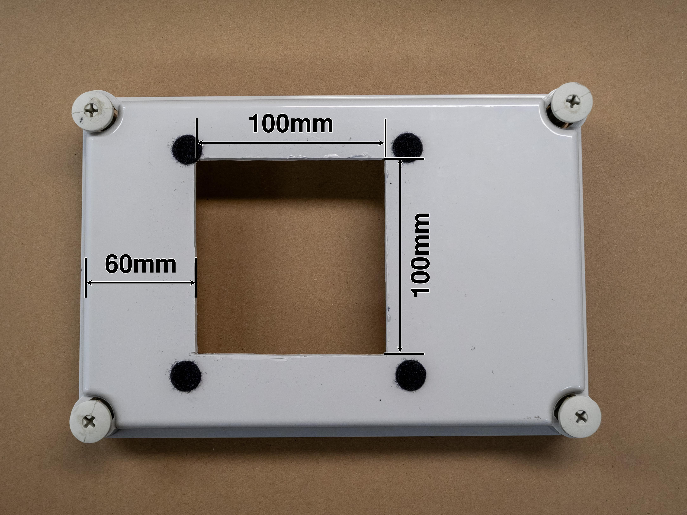
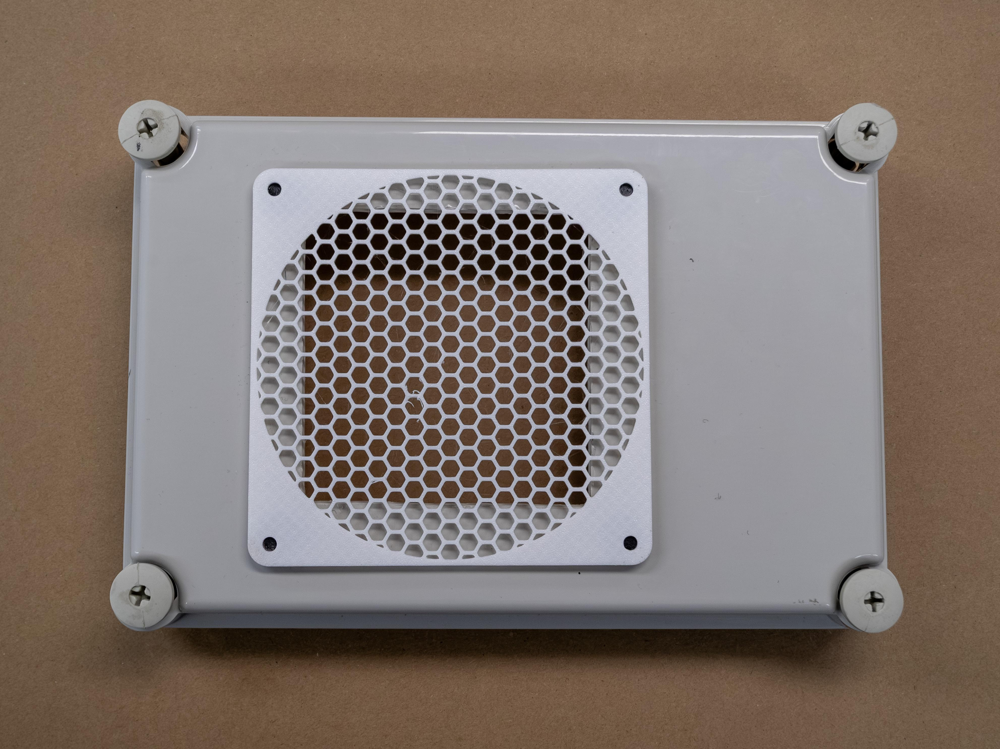

.. _doc_offroad_enclosure:

2. Preparing the Enclosure
==========================

The enclosure is a plastic project box that carries the compute and electronics. It is a modified off-the-shelf electrical box. You cut openings for cables and ventilation and drill the mounting holes. All dimensions in the photos are in millimetres. The sides of the box facing the front and back of the car are indicated, be mindful of the correct orientation!

Bottom
------

**1. Drill the mounting holes.**

Using the 3D-printed drill guides, drill the mounting holes at the circled positions. Make sure to check the correct orientation of the guides to ensure the holes will line up with the standoffs on the chassis.

   Bottom mounting holes (circled).

**2. Cut the cable opening.**

Cut the rectangular opening in the floor of the box. The motor and servo wires from the chassis pass through it. You can use a drill to create an initial hole, followed by a jigsaw to complete the rectangular opening. Alternatively, rotary tools may be used to create the opening.

   Bottom opening, seen from below.

Front and side
--------------

**3. Prepare the camera mount holes.**

Drill the two 5 mm holes for the camera mount bracket, and cut the small slot between them for the camera cable. You can use a 12mm or 1/2 inch drill to create the start and end point of the slot and a jigsaw or file to complete the opening. The slot for the camera cable should be centered left-to-right on the front face of the box.

.. tip::
   Use the ZED camera mounting bracket to double-check the hole spacing.

   Front face with the bracket holes and cable slot.

**4. Cut the side openings.**

Cut the two rectangular openings on the left side for the battery cables and the cables to the Jetson. Stick the Velcro™ dots next to them, where the battery monitor goes later.

   Left side openings.

Lid
---

**5. Cut the lid vent.**

Cut the square opening in the lid so the Jetson fan can breathe, the opening should be centered left-to-right, but dimensions are not crucial. Then fasten the vent guard over it. We used Velcro™ dots for this to allow for easy removal and installation.

   Lid opening.

   Vent guard on the lid.

.. todo::
   Confirm which edge each dimension is measured from, the box model, and whether the vent guard is a printed part (add the file).
