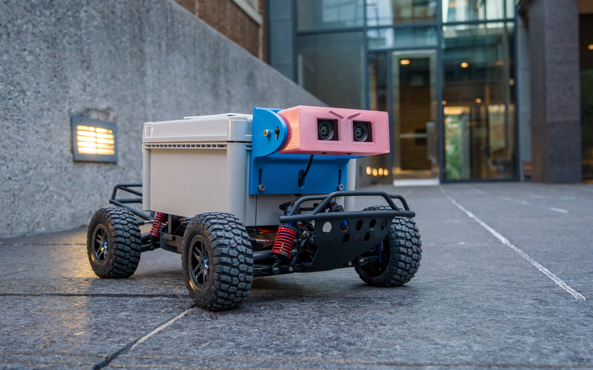

.. _doc_offroad_intro:

Introduction
============

The RoboRacer Off-Road is a 1/10-scale RC vehicle for autonomous driving on uneven, hilly terrain such as pump tracks and outdoor circuits. It runs `Autoware <https://github.com/mlab-upenn/autoware.roboracer>`_ on an NVIDIA Jetson AGX Orin and senses its surroundings with a ZED depth camera.

Compared with the standard RoboRacer car, the Off-Road platform differs in these ways:

* **Software:** Autoware (ROS 2 Humble, based on Autoware 1.6.0) instead of the standard RoboRacer ROS 2 stack.
* **Compute:** Jetson AGX Orin (JetPack 6.2.1) instead of the Jetson Xavier NX.
* **Sensing:** a ZED depth camera instead of a 2D lidar.
* **Terrain:** the Autoware configuration is tuned for slopes, banked turns and crests, with some obstacle-handling modules disabled. See the `Off-Road configuration <https://github.com/mlab-upenn/autoware.roboracer/blob/roboracer_humble/docs/configuration/roboracer-offroad.md>`_ for the trade-offs.

How this section is organized
-----------------------------

#. :ref:`Building the car <doc_offroad_build>`: the lower-level chassis, the enclosure, the autonomy elements, and final assembly.
#. :ref:`Autoware stack <doc_offroad_autoware>`: installing Autoware on the Jetson (or an x86 host), launch modes, and driving the vehicle.
#. :ref:`Off-road simulator <doc_offroad_simulator>`: running the vehicle in simulation, with or without the real Jetson.

If you only want to try the software, you can skip the build and start with the simulator.

.. note::
   If you have any questions, post to the `RoboRacer Slack <https://join.slack.com/t/robo-racer/shared_invite/zt-42lsbf50y-_3YPNLl_d3s~wPylAOMg0g>`_.
