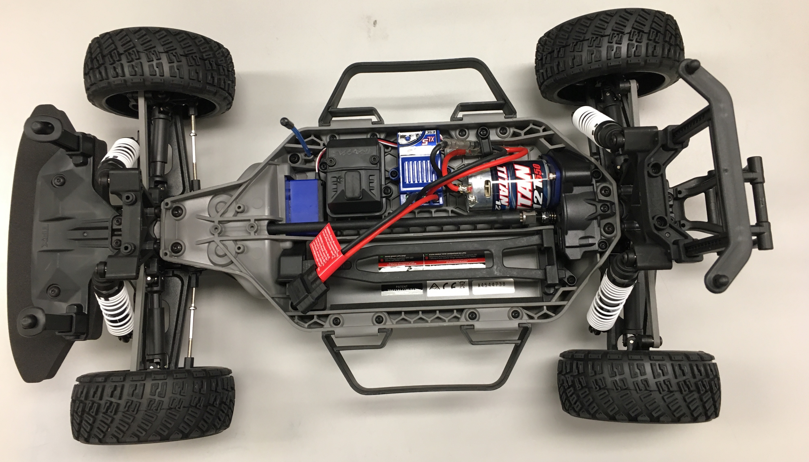
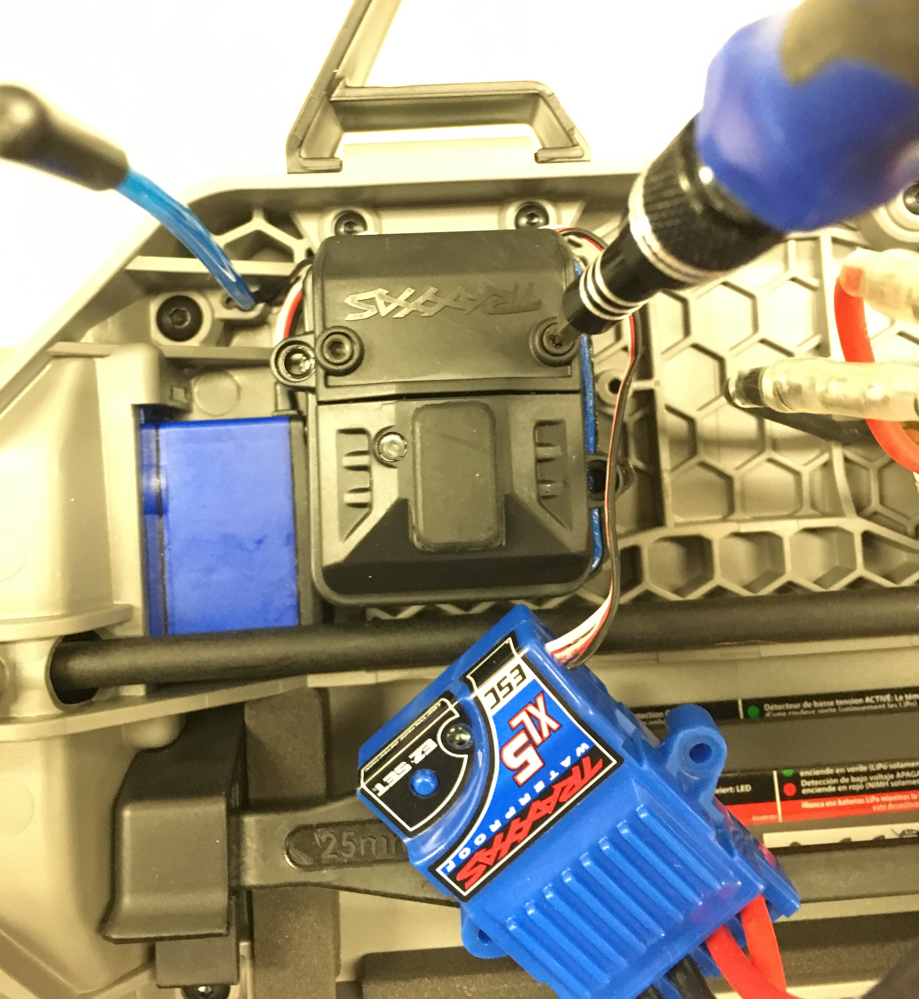
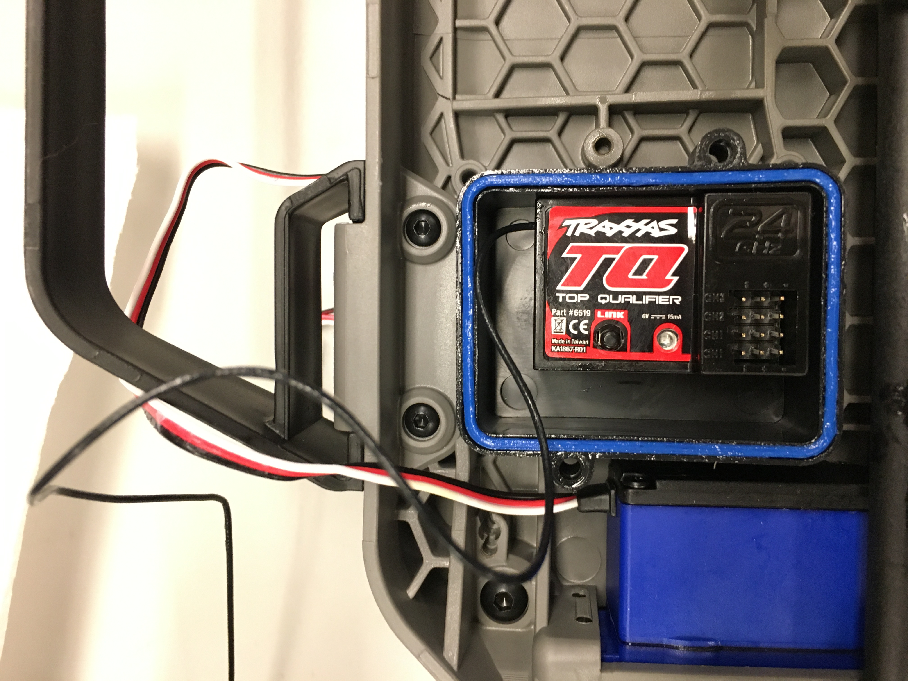
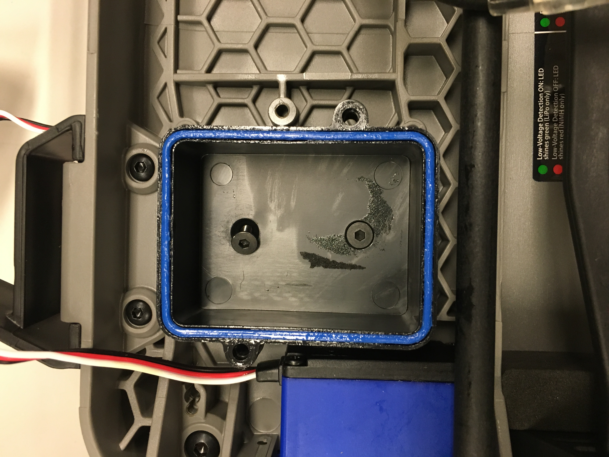
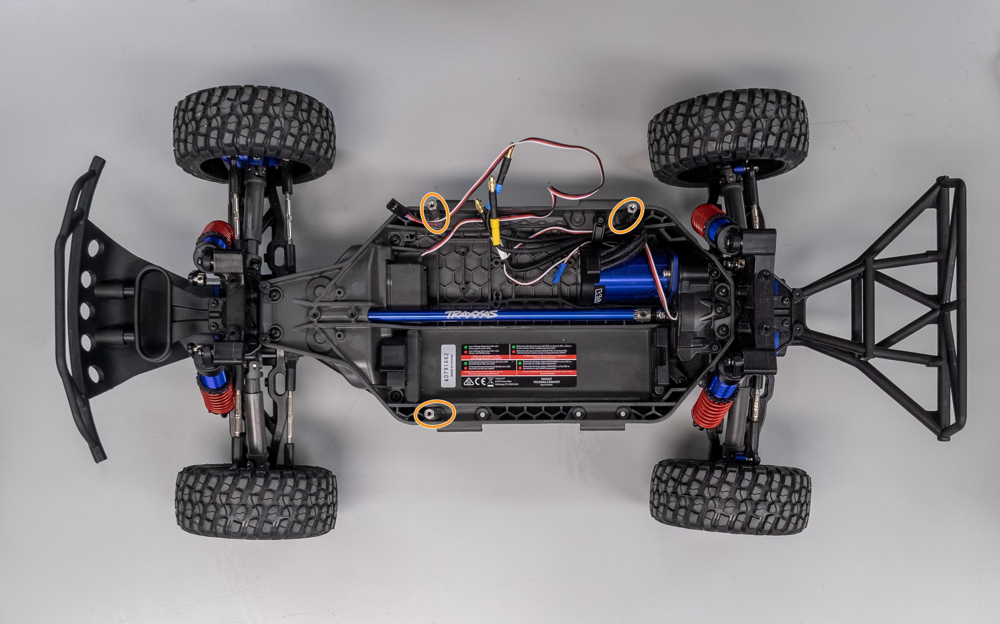
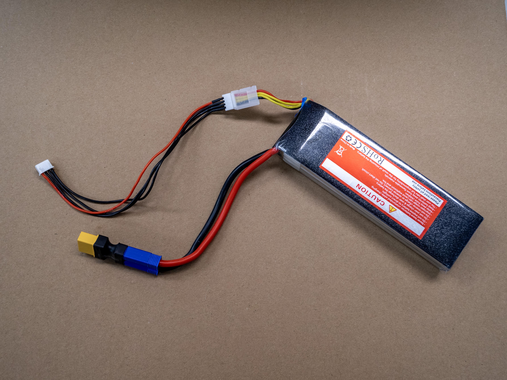

.. _doc_offroad_lower_chassis:

1. Lower-Level Chassis
======================

The lower-level chassis is the rolling RC platform. You strip the stock electronics, add the standoffs that the enclosure sits on, and set up the battery. These steps are the same as in the :ref:`standard RoboRacer build <doc_build_lower_level>`.

.. note::
   The first photos on this page come from the standard RoboRacer build and show a slightly different chassis. The steps are the same. The last photo shows the standoff locations on the RoboRacer Off-Road chassis.

Removing the stock components
-----------------------------

**1. Remove the body.**

Take the chassis from its box. Remove the four body clips and lift off the body.

   Chassis with the body removed.

**2. Remove the stock ESC.**

The three hex keys that come with the chassis fit almost all of its screws. Keep the screws in a bowl, because you will need them later. Remove the two screws that hold the stock ESC to the chassis. Disconnect the wires from the ESC to the motor by pulling the bullet connectors apart.

**3. Remove the receiver box.**

Unscrew the lid of the black receiver box. Disconnect the ESC and servo control wires from the receiver, then pry the receiver off the bottom of the box. It is held with double-sided tape.

   Unscrewing the top of the receiver box.

   Inside of the receiver box.

**4. Unscrew the receiver box.**

Remove the two screws that mount the receiver box to the chassis. Remove the antenna tube with a screwdriver or pliers if it is in the way.

   Receiver box screws, visible once the box is out.

Standoffs
---------

**5. Attach the standoffs.**

Remove the two nerf bars (black handles) from the sides of the chassis. Each is held by four screws that are accessible from underneath. Attach the three 45 mm M3 standoffs from underneath the chassis with M3 screws, with two standoffs on the motor side and one on the battery side as shown. This leaves room to reach the battery. Thread-locking fluid helps, because vibration can loosen the standoffs.

   Standoffs installed on the RoboRacer Off-Road chassis (circled).

Battery
-------

**6. Prepare the battery.**

Fit the LiPo battery with the EC5 to XT90 connector adapter so that it can later mate with the VESC power connector. Connect the balance lead extension. This will be used to connect a battery monitor.

   LiPo battery with its power adapter.

